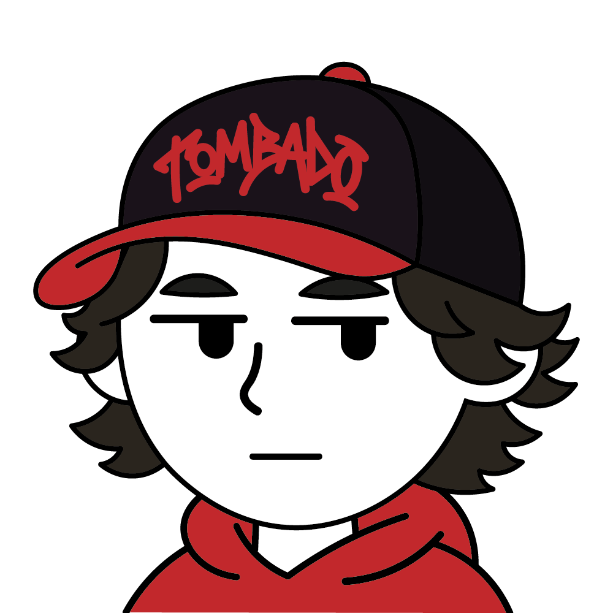
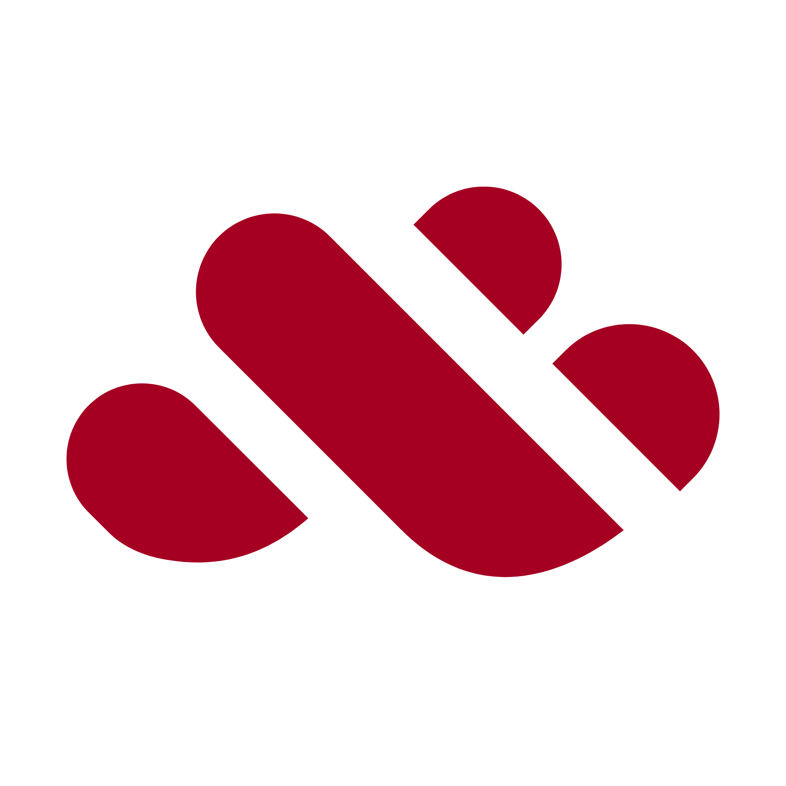

<table>
  <tr>
    <td width="200">
      
    </td>
    <td>
      <h1>Hola, Soy Santiago Sarmiento</h1>
      <h3>Developer · Founder · Technology Enthusiast</h3>
      

        Desarrollador y fundador de Nexora, enfocado en crear software,
        experiencias digitales y productos tecnológicos con una visión a largo plazo.
        Me interesa construir tecnología útil, cuidar cada detalle y entender los
        sistemas desde el código hasta su funcionamiento interno.
      

      <!-- 

        Actualmente trabajo en el desarrollo de Nexora y continúo ampliando
        mis conocimientos en programación, Linux, arquitectura de software
        y diseño de productos.
      
 -->
    </td>
  </tr>
</table>

## Encuéntrame en

  
  
  
  
  

## Mi stack tecnológico

  
   
  
   
  
   
  

## Estadísticas de GitHub

<table>
  <tr>
    <td>
      
    </td>
    <td>
     
    </td>
  </tr>
</table>

## Fundador de Nexora

<table>
  <tr>
    <td width="150">
     
    </td>
    <td>
      <h2>Nexora</h2>
      <h3> Tecnología diseñada para ir más allá.</h3>
      

        Fundador y CEO de Nexora, una iniciativa tecnológica orientada al desarrollo
  de software, dispositivos y un ecosistema digital integrado.
  Mi objetivo es contribuir a construir productos coherentes, accesibles
  y técnicamente sólidos.
      

      

  
  

    </td>
  </tr>
</table>

---

  <i>Construyendo, aprendiendo y mejorando una línea de código a la vez.</i>

